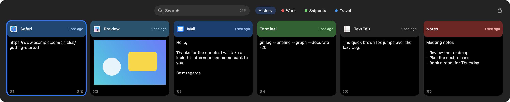
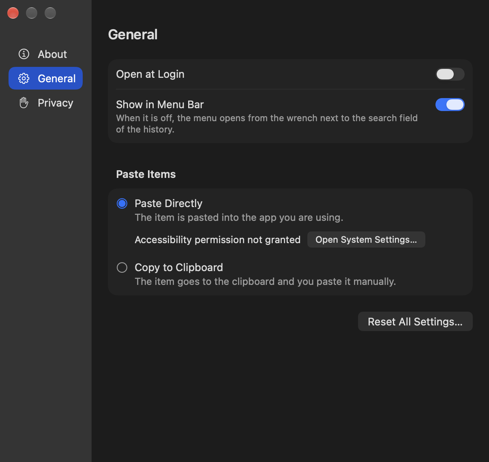
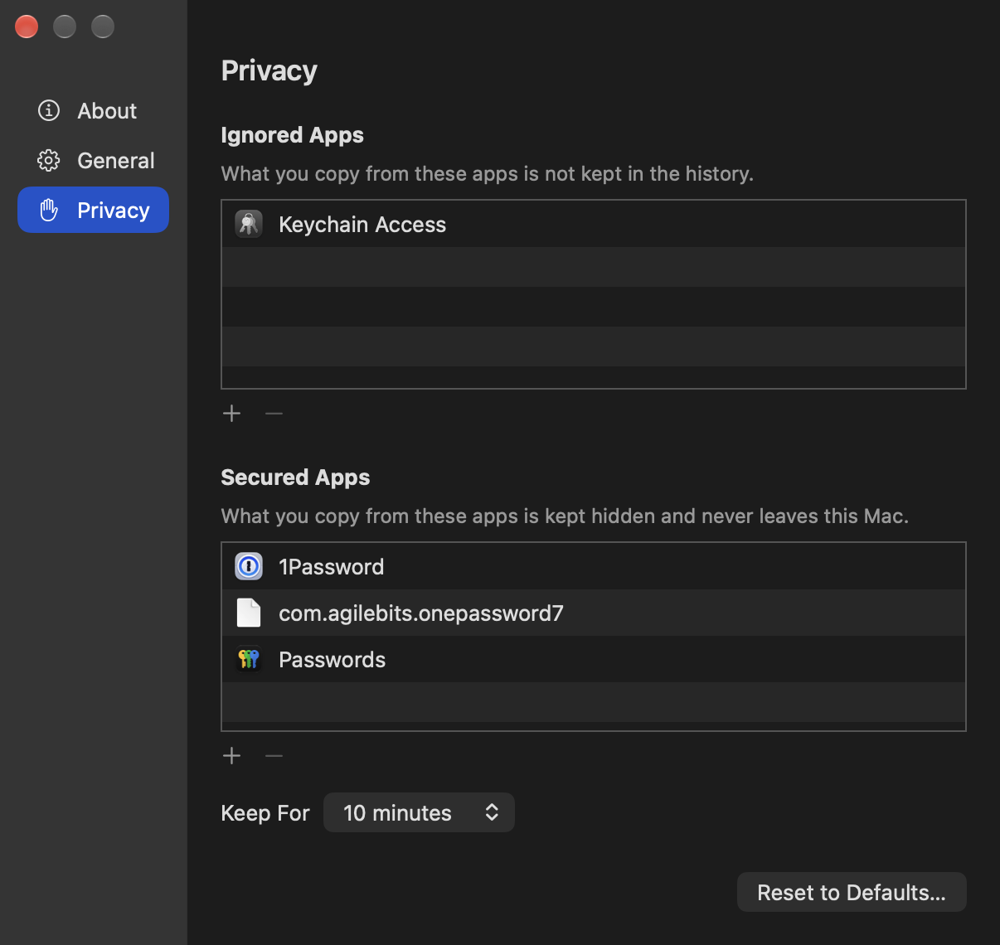
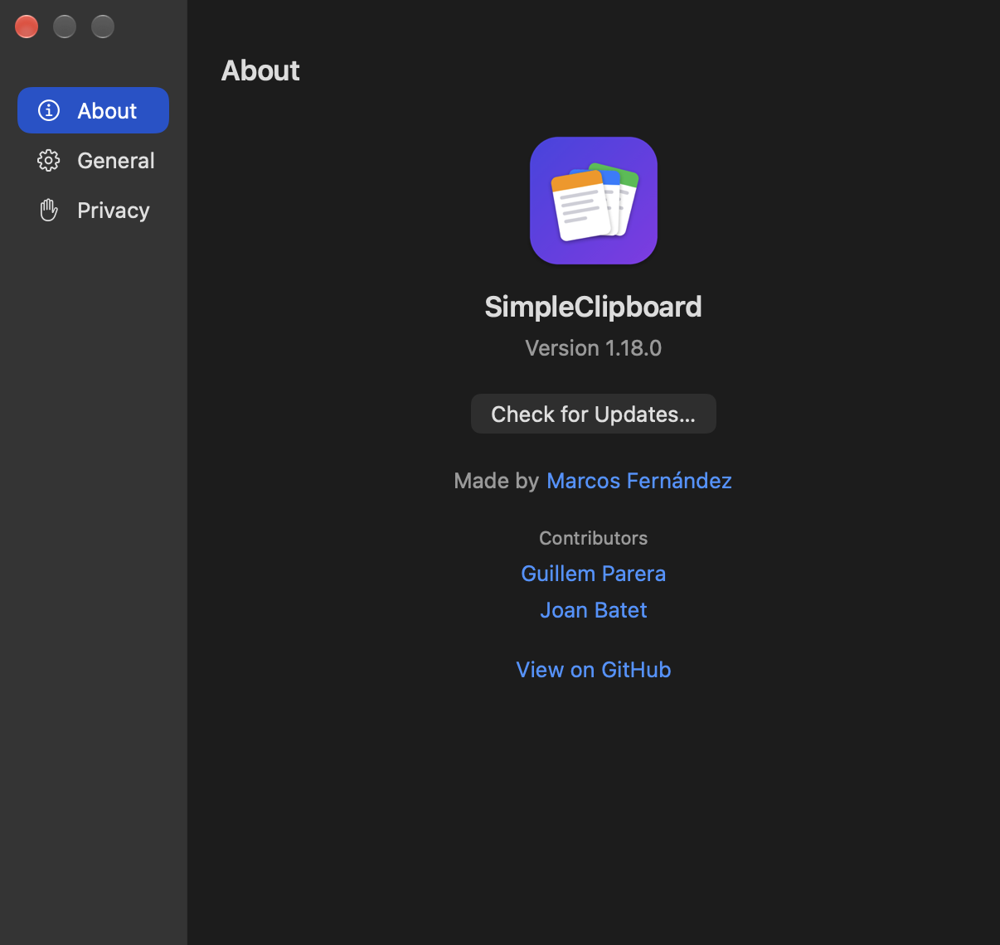

# SimpleClipboard

A clipboard manager for macOS: everything you copy, text and images, one shortcut away. Press `⇧⌘V`, pick a card and
it is pasted where you were typing.



It is free, open source (MIT) and keeps your data on your Mac: the app sends nothing from the clipboard anywhere.
Backup and sync are optional, and go through your own iCloud Drive.

## Features

- **History of text and images.** The last 1000 copies or 30 days, each on a card that shows the app it came from.
- **One shortcut.** `⇧⌘V` opens the history over whatever you are doing; `Enter` pastes the selected card into the
  app you were in, or `⌘1`…`⌘9` the card with that number.
- **Search.** Just start typing with the history open.
- **Tags.** Named, coloured collections that show as tabs. A tagged item never expires: snippets, addresses,
  answers you write again and again.
- **Passwords stay out.** What you copy from a password manager is kept hidden, in memory only, and goes after 10
  minutes. Other apps can be ignored altogether.
- **Pause.** Stop recording for a few minutes or a few hours.
- **Share.** Send a card through the share menu of macOS.
- **Backup and sync through iCloud Drive.** Optional: an hourly backup, and the same history and tags on all your
  Macs.
- **Updates from the menu.** The app tells you when there is a new release and installs it for you.
- **Light and dark.** It follows the appearance of the system.

## Install

Requires macOS 14 or later, on Apple Silicon or Intel.

### From the terminal (recommended)

```bash
curl -fsSL https://raw.githubusercontent.com/marcos-fernandez/simpleclipboard/main/scripts/install.sh | bash
```

A browser marks what it downloads as quarantined, which is what makes macOS refuse an app that is not notarized;
`curl` does not, so an app installed this way opens without "Open Anyway". The same command updates an installed
copy.

[`scripts/install.sh`](scripts/install.sh) downloads the latest release's disk image, quits the running copy if there
is one, replaces `/Applications/SimpleClipboard.app` and opens it. It stops at the first step that fails.

### From the disk image

1. Download the `.dmg` from the [latest release](../../releases/latest) (`universal`: one build for Apple Silicon
   and Intel), open it and drag `SimpleClipboard.app` to Applications. Do not run it from the disk image: the
   permission and "Open at Login" would point to a volume that is gone once ejected.
2. Open it. The app is not notarized by Apple, so macOS refuses the first time: go to System Settings > Privacy &
   Security and click "Open Anyway" (or run `xattr -dr com.apple.quarantine /Applications/SimpleClipboard.app`).

### The first launch

The app asks how to paste what you pick ("Paste Directly" or "Copy to Clipboard", which it starts on) and whether
to open at login. Both can be changed later in Settings.

### Permissions

- **Accessibility**: needed to paste directly (it simulates `⌘V`). Without it, the item is only copied to the
  clipboard. The app only asks for it while Settings is set to "Paste Directly".
- If macOS asks about clipboard access, choose "Always Allow".

### Updates

The app checks GitHub for a new release shortly after launch and then once a day; "Check for Updates…" in
Settings > About checks right away. When there is one, the menu-bar icon turns blue, with an arrow (as does the
menu button of the history), and the menu shows "Update Available". Choosing it downloads the release's disk image,
checks that the app in it is signed like the running one and is the version offered, puts it in place and
asks whether to restart now. If any of that fails, it offers the release page instead. A copy built from the source
code is not signed like the releases, so it always ends at the release page.

The check, and the download once you choose the update, are the only network requests the app makes; nothing from
the clipboard is sent.

## Using it

### The history

`⇧⌘V` opens it at the bottom of the screen the pointer is on, over the Dock, with the keyboard on its cards, at most
nine in view.

| Key | What it does |
| --- | --- |
| `⇧⌘V` | Open or close the history |
| `←` `→` | Move between cards |
| `Enter` | Paste the selected card, or copy it (see Settings) |
| `⌘1`…`⌘9` | The same for the card with that number |
| any text, or `⌘F` | Search |
| `Esc` | Clear the search, or close |
| `⌘←` `⌘→` | Switch tab |
| `⌘T` | Tag the selected card |
| `⌘⌫` | Delete the selected card |

Right-click a card or a tab for more options.

The header of a card has the colour of its tag or, without one, that of the icon of the app it was copied from, next
to that icon; it stays grey for an icon without a colour of its own, a grey one or one of several colours. The cards
are black in the dark appearance of the system and white in the light one.

A search, and the tab it was made in, are still there when the history is opened again, until a card is picked:
closing it by mistake does not lose them.

### Tags

`⌘T`, or "Tag" in the menu of a card, puts the card under a tag or creates one with "New Tag…". Each tag is a tab
next to "History", in its colour; right-click a tab to rename, recolour or delete it. Tagged items are kept until
you delete them, and "Clear History…" leaves them alone.

### Share

The selected card can be shared from the button at the end of the search row, and any card from its menu, through
the share menu of macOS; not the ones copied from the "Secured Apps".

### The menu

The menu-bar icon opens the menu: "Open History", "Clear History…", the backup and the sync between Macs,
"Settings…", "Pause" and "Quit". The same menu opens from the button at the top left of the history, which shows
the same icon and is there whether the menu-bar icon is shown or hidden (see Settings).

### Pause

"Pause" in the menu stops recording for 5, 15 or 30 minutes, or 1, 4 or 8 hours: what you copy meanwhile is not
kept, then or later. The menu-bar icon is dimmed meanwhile and the menu says until when; "Resume", in that same
submenu, ends it before its time. The history still opens and pastes while paused, and quitting the app does not end
the pause. A pause is of this Mac only: another Mac of yours that is not paused still records what it copies, and
what Universal Clipboard hands it from this one, and with sync between Macs that comes back here.

## Settings

"Settings…" in the menu (`⌘,` while the menu is open) opens a window with a pane per row of its sidebar (`↑` `↓`
change pane, unless a list has the focus). With the Settings window in front, a picked item is only copied.

### General



- **Open at Login.**
- **Show in Menu Bar**, which hides the menu-bar icon when off: its menu still opens from the button at the top
  left of the history (`⇧⌘V`). If `⇧⌘V` cannot be registered the icon stays, as nothing else would open the
  app. Opening the app again (from Finder or Spotlight) also shows the history, for when another app has taken
  `⇧⌘V`; an item picked there is only copied, as SimpleClipboard is then the app in front.
- **Paste Items**: what happens when an item is picked. "Paste Directly", or "Copy to Clipboard", which leaves the
  pasting to you.
- **Reset All Settings…** puts the settings back to their defaults and restarts the app, which then asks again how
  to paste and whether to open at login. A pause ends; the history, the tags and the backup stay as they are.

### Appearance

- **Density**: the size of the cards of the history. "Comfortable", or "Compact", with smaller cards: the history
  takes less of the screen and shows more of them, up to the nine it shows at most.
- **Font**: of the text of the cards. "System", or "Monospaced", in which columns and code keep their shape.

### Privacy



Two lists of apps:

- **Ignored Apps**: what you copy from them is not kept in the history. Keychain Access is there from the start.
- **Secured Apps**: what you copy from them is kept hidden, in memory only, and never reaches the backup or the
  other Macs. 1Password and Passwords are there from the start. "Keep For" sets how long it is kept: 1, 5, 10 (the
  default) or 30 minutes, counted for what is copied from then on.

In both lists, `+` adds apps and `−` or `⌫` remove the selected one, the ones from the start too. An app shows in
one list only, and ignored wins: adding a secured app to the ignored ones hides it among the secured, where it shows
again once it is no longer ignored; adding an ignored app to the secured ones is refused. A list you have changed is
yours from then on: an app that a later version adds to the ones from the start does not reach it. "Reset to
Defaults…" leaves the lists and the time as a new install has them, with whatever that version starts from.

The lists go by the app in front when you copy: a copy made from a menu-bar icon, or by an app working in the
background, is not recognised as coming from that app and is kept as any other. What was copied from an app before
it was added stays as it was. Each Mac has its own lists: with sync between Macs, add the app on every one.

### About



The version, "Check for Updates…" to look for a release now and not at the daily check, who makes the app, its
contributors and a link to this repository.

## Backup and sync

Both are optional and go through iCloud Drive, so they need the same iCloud account on each Mac. Anything copied
from the "Secured Apps" is never included.

### Backup

`~/Library/Mobile Documents/com~apple~CloudDocs/SimpleClipboard/Backup/`, automatic every hour when something
changed, or from the menu ("Back Up Now", "Restore…"). There is a single backup: if two Macs back up, each one
replaces the other's. "Restore" replaces the local history and tags.

On a new Mac, the existing backup is restored automatically only while that Mac has nothing copied yet; once it
does, the menu shows "Backup not restored" until you choose between restoring ("Restore…") and making a new backup
("Back Up Now"). The automatic backup also waits for that choice whenever the backup in iCloud Drive was not made
or restored from this Mac, or a damaged local file could not be recovered, so it never replaces the backup with
less than it holds.

### Sync between Macs

With "Sync Between Macs" turned on in the menu of each Mac, the history and the tags stay the same through
`iCloud Drive/SimpleClipboard/Sync/`: whatever is copied, deleted or tagged on one shows up on the other once
iCloud Drive uploads and downloads the files (from seconds to a couple of minutes). A deletion reaches both Macs;
to undo it, "Restore…" brings the backup back on both.

When it is first turned on on a Mac, its history is joined with the others' without duplicating anything. Tags with
the same name are merged into one, even if you created them that way on purpose, and so are two tags when one is
renamed to the other's name.

## Where the data lives

`~/Library/Application Support/SimpleClipboard/` (`history.json`, `tags.json` and `images/`). Changes are written
in the background right after they happen; quitting the app writes any still on their way, and a crash or power cut
can only lose those (normally the last fraction of a second).

The last 1000 untagged items or 30 days. Tagged items are kept unless you delete them (`⌘⌫`) or copy the same value
from one of the "Secured Apps" (it then becomes an in-memory-only copy). "Clear History…" deletes only untagged
items.

Each save also writes a copy of `history.json` and `tags.json` as `.prev`: if a file is found damaged at launch, it
is moved to `.bak` and the `.prev` copy is loaded instead. If `tags.json` cannot be recovered either, its items stay
tagged under tags named "Recovered …" until the real ones come back (from another Mac through sync, or a repaired
file).

## Build from source

Needs the Command Line Tools (`xcode-select --install`). Xcode is not needed.

```bash
scripts/test.sh                # unit tests (sets the Swift Testing plugin path)
scripts/build-app.sh           # creates build/SimpleClipboard.app
osascript -e 'quit app "SimpleClipboard"' || true   # a normal quit, so the last changes are written
ditto build/SimpleClipboard.app /Applications/SimpleClipboard.app
open /Applications/SimpleClipboard.app
```

To keep the Accessibility permission across rebuilds, create a certificate once in Keychain Access > Certificate
Assistant > Create a Certificate… (Name: `Clipboard Local Signing`, Identity Type: Self Signed Root, Certificate
Type: Code Signing).

## It used to be called Clipboard

On the first launch of SimpleClipboard, `~/Library/Application Support/Clipboard/` and the `Clipboard` folder in
iCloud Drive are moved to their new names automatically, and the backup state is kept. Only folders that hold the
old app's data are moved (`history.json`; a `Backup` or `Sync` folder): another `Clipboard` folder is left alone.
The Accessibility permission and the login item have to be granted again.
